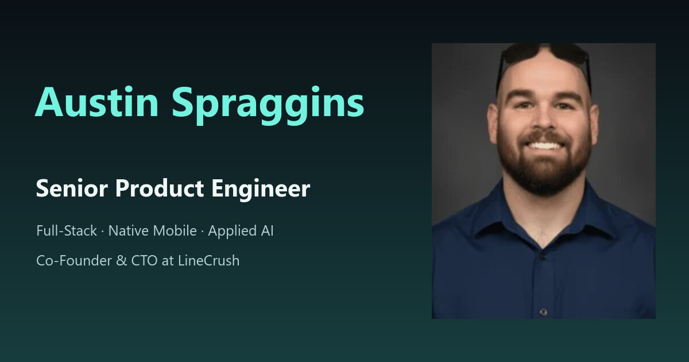

# Austin Spraggins Portfolio

Personal portfolio website showcasing my work as **Co-Founder, CTO & Senior Software Engineer** at [LineCrush Inc](https://www.linecrush.com).



## Live Site

**[spragginsdesigns.xyz](https://www.spragginsdesigns.xyz/)**

## About Me

I build AI agents that ship production software - and the platforms they run. At LineCrush, that includes:

- **43,000+ monorepo commits** across product, data, native, agent, and game work (source of truth: `src/lib/stats.ts`)
- **Autonomous agent fleet:** 14,111 completed fleet jobs since June 23, 2026, including 10,745 completed jobs with a recorded commit link (ledger snapshot November 17, 2026)
- **~2,300 tracked TSX modules** and **725 API handlers**
- **70 tracked agent skills** powering autonomous investigation, implementation, proof, review, and release
- **Multi-model product intelligence** across OpenAI, Gemini, Claude, Perplexity, and vision/OCR workflows
- **Four client surfaces:** web, native iOS, native Android, and browser extensions
- **LineCrush Games:** Gunmetal Orbit, a space-mining arena roguelite [available on Steam September 10, 2026](https://store.steampowered.com/app/4975430)

LineCrush is stable and [doesn't need me full time anymore](https://www.spragginsdesigns.xyz/blog/2026-11-19-linecrush-doesnt-need-me-full-time-anymore), so I'm looking for my next full-time, hands-on engineering job. Also open to contracts and consulting.

## Tech Stack

### Portfolio Built With
- **Framework:** Next.js 14 (App Router + Pages Router hybrid)
- **UI:** React 18, TypeScript, Tailwind CSS
- **Components:** shadcn/ui, Aceternity UI
- **Animations:** Framer Motion
- **Icons:** Lucide React
- **Deployment:** Vercel

### My Professional Stack (at LineCrush)
- **Frontend:** Next.js 15, React, TypeScript, Tailwind CSS
- **Backend:** Python, Node.js
- **Database:** PostgreSQL (Neon), Redis
- **AI/Agents:** Codex, Claude, OpenAI, Gemini, Perplexity, MCP, vision/OCR
- **Native & Games:** SwiftUI, Kotlin/Compose, Godot 4.7, GDScript
- **Infrastructure:** AWS (S3, SES, CloudFront), Ubuntu VPS, Docker

## Features

- **Selected work:** LineCrush, SureWord, C2, Gunmetal Orbit, paid client work, and open-source contributions.
- **Engineering case studies:** [LineCrush](https://www.spragginsdesigns.xyz/work/linecrush), [SureWord](https://www.spragginsdesigns.xyz/work/sureword), [game development](https://www.spragginsdesigns.xyz/work/game-development), and [client work and public tools](https://www.spragginsdesigns.xyz/work/independent).
- **Journey:** Career milestones from trucking through teaching and co-founding LineCrush, with a sourced work log.
- **Faith:** Austin's testimony and why he built SureWord, on its own [page](https://www.spragginsdesigns.xyz/faith).
- **Résumé:** A mobile-friendly [résumé page](https://www.spragginsdesigns.xyz/resume) with a PDF download.
- **Dedicated pages:** LineCrush Games, Fresno business websites, and the engineering blog.
- **SEO:** Route-specific canonical URLs and social cards, static case studies with Article and Breadcrumb structured data, sitemap, and robots.txt.
- **Product imagery:** Original LineCrush and SureWord app captures from their App Store assets, plus existing Gunmetal Orbit gameplay art.

## Getting Started

```bash
# Install dependencies
pnpm install

# Run development server
pnpm dev

# Build for production
pnpm build

# Start production server
pnpm start
```

## Environment Variables

Create `.env.local` with server-only secrets as needed:
```
GMAIL_APP_PASSWORD=your_gmail_app_password
YOUTUBE_API_KEY=your_youtube_api_key
OPENAI_API_KEY=your_openai_api_key   # portfolio agent, see docs/ask-agent.md
```

Never expose provider tokens through `NEXT_PUBLIC_*` variables. Public GitHub profile data is fetched without a client-side token.

## Connect With Me

- **GitHub:** [github.com/spragginsdesigns](https://github.com/spragginsdesigns)
- **LinkedIn:** [linkedin.com/in/spragginsdesigns](https://www.linkedin.com/in/spragginsdesigns/)
- **Twitter:** [@spragginsdesign](https://twitter.com/spragginsdesign)
- **Website:** [spragginsdesigns.xyz](https://www.spragginsdesigns.xyz/)

## License

MIT License - feel free to use this as inspiration for your own portfolio!
